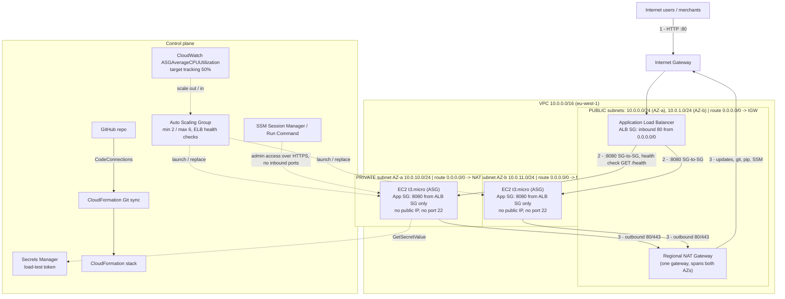

# Architecture

Paste the Mermaid block into draw.io (*Arrange → Insert → Advanced → Mermaid*) or [mermaid.live](https://mermaid.live),
then restyle it with official AWS icons and export it as `docs/architecture.png`.

## Legend
| Number | Flow |
|---|---|
| 1 | User → Internet Gateway → ALB (the only public endpoint) |
| 2 | ALB → instance on port 8080. Allowed only because the App SG references the ALB SG |
| 3 | Instance → Regional NAT → IGW. Outbound only, for updates, `git clone`, `pip` and SSM |

## Diagram checklist
- [ ] VPC and CIDR, 2 Availability Zones
- [ ] Public subnets (ALB, Regional NAT) clearly labelled **public**
- [ ] Private subnets (EC2 in the ASG) clearly labelled **private**
- [ ] IGW and route tables (public to IGW, private to NAT)
- [ ] Security group rules on the arrows
- [ ] Numbered traffic flows
- [ ] Control plane: ASG, CloudWatch target tracking, SSM, Secrets Manager, Git → Git sync → CloudFormation
- [ ] Official AWS icons and a legend; export as PNG into `docs/`
