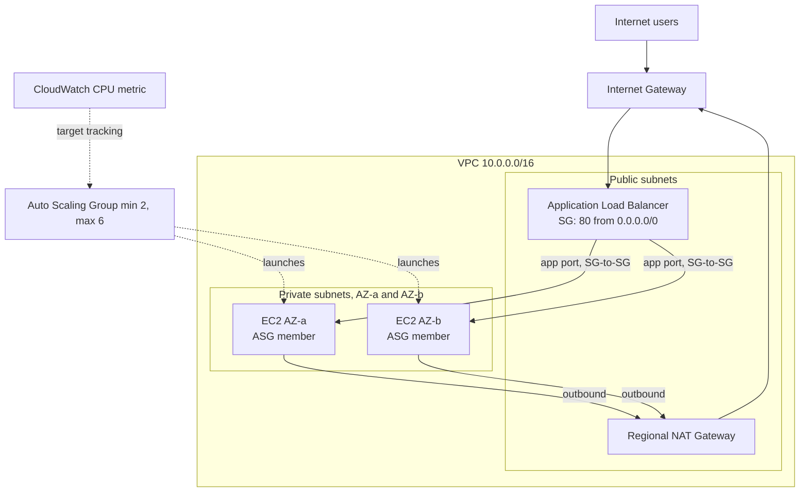

# Onward Logistics: Sales Day Demand Lab
### Implementation Guide and Roadmap (AWS CloudFormation + GitSync)

> **Module:** Compute & Delivery on AWS, Week 3
> **Goal:** Highly available, auto-scaling, private-compute order system behind a single public ALB, fully provisioned by CloudFormation and deployed through GitSync.

> **Note:** The *Client Profile* and *Discovery Report Template* were referenced in the lab but not provided. Everything marked `<PLACEHOLDER>` (naming convention, mandatory tags, region) must be replaced with the values from the Client Profile.

---

## Table of Contents
1. [Requirements Traceability](#1-requirements-traceability)
2. [Target Architecture](#2-target-architecture)
3. [Design Decisions and Rejected Alternatives](#3-design-decisions-and-rejected-alternatives)
4. [Roadmap (Phases and Checklists)](#4-roadmap-phases-and-checklists)
5. [Repository Layout](#5-repository-layout)
6. [GitSync Setup](#6-gitsync-setup)
7. [CloudFormation Template Blueprint](#7-cloudformation-template-blueprint)
8. [Application Code](#8-application-code)
9. [Live Review: Test and Proof Plan](#9-live-review-test-and-proof-plan)
10. [Cost Model for the Finance Lead](#10-cost-model-for-the-finance-lead)
11. [Discovery Report Outline (Stage 1)](#11-discovery-report-outline-stage-1)
12. [Architecture Diagram Checklist](#12-architecture-diagram-checklist)
13. [Common Pitfalls](#13-common-pitfalls)
14. [Rubric Mapping and Final Submission Checklist](#14-rubric-mapping-and-final-submission-checklist)

---

## 1. Requirements Traceability

| Stakeholder / Objective | Requirement | AWS Design Answer |
|---|---|---|
| **CTO**: auto adjust on CPU spikes, scale back in | Elastic compute | EC2 Auto Scaling Group + **target tracking** policy on `ASGAverageCPUUtilization` (~50%) |
| **Head of Security**: one public entry point; servers never directly reachable; no admin ports | Network isolation | Internet-facing **ALB** in public subnets. EC2 in **private subnets**, SG allows app port **only from the ALB SG**. No SSH (port 22 closed); access via **SSM Session Manager** |
| **Head of Ops**: survive server or AZ loss; see which server answered | HA + observability | ASG across ≥2 AZs, `min >= 2`, **ELB health checks**, page shows instance ID + AZ, ALB target group health view |
| **Finance Lead**: cost quiet vs peak day, and why | Cost transparency | Small burstable instances, min size 2, scale-in after rush, single Regional NAT Gateway; cost table in section 10 |
| Private servers can download updates | Outbound only | **Regional NAT Gateway** + private route tables (`0.0.0.0/0` to NAT) |
| Everything as code | Mandatory | CloudFormation only, **GitSync** from Git repo, **no inline IAM policies** |
| Spike trigger demo | Mandatory | Token-protected "Generate Load" UI on the app, and/or SSM Run Command (`stress-ng`) |
| Company standards | Mandatory | Naming convention and tags from Client Profile applied to every resource |

---

## 2. Target Architecture

```
                           Internet
                              |
                      [ Internet Gateway ]
                              |
      +-----------------------+-----------------------------------+
      | VPC 10.0.0.0/16                                           |
      |                                                           |
      |   Public subnets (one per AZ)                             |
      |   +------------------------+   +------------------------+ |
      |   | AZ-a 10.0.0.0/24       |   | AZ-b 10.0.1.0/24       | |
      |   |   ALB node             |   |   ALB node             | |
      |   +-----------+------------+   +-----------+------------+ |
      |               |    ALB SG: 80/443 from 0.0.0.0/0          |
      |               v                            v              |
      |   Private subnets (one per AZ)                            |
      |   +------------------------+   +------------------------+ |
      |   | AZ-a 10.0.10.0/24      |   | AZ-b 10.0.11.0/24      | |
      |   |  EC2 (ASG member)      |   |  EC2 (ASG member)      | |
      |   +-----------+------------+   +-----------+------------+ |
      |        App SG: app port ONLY from ALB SG                  |
      |               |  outbound 0.0.0.0/0                       |
      |               v                                           |
      |      [ Regional NAT Gateway ]  --> IGW (updates, git, SSM)|
      +-----------------------------------------------------------+

 Control plane: CloudWatch (CPU alarms from target tracking), SSM Session Manager,
 Secrets Manager (load-test token), CloudFormation GitSync (deploys from Git).
```

**Traffic flow:** Client → ALB DNS name (public) → target group (health-checked) → EC2 in private subnet → response. Instances initiate outbound traffic (OS updates, `git clone`, `pip install`, SSM) → NAT Gateway → IGW.

### Mermaid version (paste into any Mermaid renderer or draw.io for the final diagram)



---

## 3. Design Decisions and Rejected Alternatives

### Chosen design
| Decision | Value | Why |
|---|---|---|
| Regions / AZs | 2 AZs minimum (3 if you want extra headroom) | Satisfies AZ-loss requirement at lowest cost |
| ASG sizing | `Min=2, Desired=2, Max=6` | Min 2 means one instance per AZ, so losing an AZ leaves capacity. Max 6 caps cost at roughly 3x peak |
| Scaling trigger | Target tracking, `ASGAverageCPUUtilization = 50` | Self-managing, scales out *and* in, no hand-tuned alarms |
| Health checks | ASG `HealthCheckType: ELB`, grace period 180s | Replaces instances that fail app-level checks, not just EC2 status checks |
| ALB health check | `GET /health`, interval 15s, healthy 2, unhealthy 2 | Fast detection of dead servers |
| Instance type | `t3.micro` (or `t2.micro`, whichever is Free Tier eligible in your account/region) | Lab requires Free Tier eligible |
| AMI | Latest Amazon Linux 2023 via public SSM parameter | No hard-coded AMI IDs, template stays portable |
| Access | SSM Session Manager, **no key pair, no port 22** | Meets "nobody opens admin ports" |
| IMDS | IMDSv2 required | Security best practice |
| IAM | `AWS::IAM::Role` + AWS managed policies / `AWS::IAM::ManagedPolicy` | **No inline policies** (do not use the `Policies:` property) |
| NAT | One **Regional NAT Gateway** | Lab requirement; one resource serves all AZs, which is cheaper and simpler than one zonal NAT per AZ |
| Config delivery | `git clone` of the app repo (pinned tag) in UserData | Explains "how the app gets onto each server"; repeatable on every scale-out |

### Rejected alternatives (use these in discovery report and live review)
| Alternative | Why rejected |
|---|---|
| Fixed peak-sized fleet all month | Pays for 3x capacity ~95% of the time. Fails CTO's cost goal |
| Manual scaling | Violates "without anyone touching it" |
| Scheduled scaling only | Sales-day timing is unpredictable. Can complement but not replace target tracking |
| Step scaling | More alarms to tune, with no benefit for a simple CPU goal |
| Public subnets + restrictive SGs | Servers would have public IPs, which breaks Head of Security's requirement |
| Bastion host / SSH | Opens admin ports, adds cost and attack surface. SSM is cheaper and safer |
| One NAT Gateway per AZ (zonal) | Higher hourly cost. Regional NAT is required by the lab |
| Single AZ | Fails AZ-loss requirement |
| Containers / Lambda / Beanstalk | Lab mandates EC2 behind an ALB. Mention as future evolution |
| Spot instances | Cheaper but interruptible. Mention as an optional optimisation for burst capacity |

---

## 4. Roadmap (Phases and Checklists)

### Phase 0: Prerequisites (Day 0)
- [ ] Read the **Client Profile**. Capture naming convention, mandatory tags, region, any CIDR standards.
- [ ] AWS account access, plus a GitHub (or GitLab/Bitbucket) account.
- [ ] Choose language: **Python (Flask)** or **Java**, per your assigned stack. This guide uses Python.
- [ ] Create the Git repo(s) and enable branch `main`.

### Phase 1: Discovery Report (before building)
- [ ] Complete both parts of the template (outline in section 11).
- [ ] Share link and include it in submission.

### Phase 2: Repository and GitSync bootstrap
- [ ] Create repo layout (section 5).
- [ ] Create the **CodeConnections** connection to your Git provider and authorise it (a one-time OAuth handshake that cannot be done in code).
- [ ] Create the **Git sync IAM role** (bootstrap template or role created once, documented in the README).
- [ ] Create the stack with Git sync enabled pointing to `deployment-file.yaml`.

### Phase 3: Network layer
- [ ] VPC, IGW, 2 public + 2 private subnets across 2 AZs.
- [ ] Public route table (`0.0.0.0/0` to IGW). Private route tables (`0.0.0.0/0` to NAT).
- [ ] Regional NAT Gateway.
- [ ] Commit, push, and watch GitSync deploy. Validate with a throwaway instance or SSM.

### Phase 4: Security and IAM
- [ ] ALB SG: inbound 80 (and 443 if you add a cert) from `0.0.0.0/0`.
- [ ] App SG: inbound app port **from ALB SG only**. No inbound from CIDRs.
- [ ] Instance role + instance profile with `AmazonSSMManagedInstanceCore` and a customer managed policy for reading the load-test secret.
- [ ] Secrets Manager secret with generated token.

### Phase 5: Application
- [ ] Build Flask app: `/` (name, lab, instance ID, AZ, load), `/health`, `/orders` (order logic), `/burn` (protected).
- [ ] Test locally.
- [ ] Tag a release (`v1.0.0`) in the app repo.

### Phase 6: Compute and elasticity
- [ ] Launch Template (AL2023, t3.micro, UserData, IMDSv2, instance profile, App SG).
- [ ] ALB, listener, target group with health checks.
- [ ] ASG (min 2 / desired 2 / max 6) in both private subnets, attached to target group.
- [ ] Target tracking scaling policy at 50% CPU.
- [ ] Outputs: ALB DNS name, ASG name, target group ARN.

### Phase 7: Prove everything (section 9)
- [ ] Load balancing across instances visible on the page.
- [ ] Scale-out and scale-in.
- [ ] Instance failure replaced.
- [ ] AZ failure survived.
- [ ] Servers unreachable directly, yet can download updates.
- [ ] Rebuild from repo (delete the stack, let GitSync recreate it, or create a fresh stack).

### Phase 8: Cost, diagram, rehearsal
- [ ] Cost table with AWS Pricing Calculator (section 10).
- [ ] Final architecture diagram (section 12).
- [ ] Rehearse the live review: code walk-through, demo script, defence of each decision.

---

## 5. Repository Layout

```
onward-sales-day/
├── README.md                    # architecture, how to deploy, bootstrap steps
├── deployment-file.yaml         # GitSync deployment file
├── infra/
│   └── template.yaml            # main CloudFormation template
├── bootstrap/
│   └── gitsync-role.yaml        # one-time: role used by Git sync
├── app/                         # (or separate repo)
│   ├── app.py
│   ├── requirements.txt
│   └── templates/index.html
└── docs/
    ├── architecture.png
    └── cost-model.md
```

---

## 6. GitSync Setup

CloudFormation Git sync watches a branch and redeploys the stack on each commit.

**`deployment-file.yaml`** (root of repo):
```yaml
template-file-path: infra/template.yaml
parameters:
  ProjectName: onward-logistics
  Environment: lab
  StudentFullName: "<YOUR FULL NAME>"
  AppRepoUrl: "https://github.com/<you>/<app-repo>.git"
  AppRepoRef: "v1.0.0"
tags:
  # <PLACEHOLDER>: mandatory tags from the Client Profile, e.g.
  Project: onward-logistics
  Environment: lab
  Owner: "<YOUR NAME>"
```

**Steps**
1. Console → *Developer Tools → Connections* (CodeConnections) → create a GitHub connection, complete the authorisation handshake.
2. Create the **sync role** with trust principal `cloudformation.sync.codeconnections.amazonaws.com`. It needs permissions for CodeConnections, plus the CloudFormation/EC2/ELB/IAM actions your stack uses. Define it in `bootstrap/gitsync-role.yaml` using **managed policies** (no inline).
3. Create the stack: *CloudFormation → Create stack → Sync from Git*. Select repo, branch, deployment file path, and the role.
4. Every `git push` to the branch now triggers a stack update. Check *Stack → Git sync* tab for status.

> **Compliance note:** The connection authorisation is an unavoidable one-time console step. Document it in the README as "bootstrap", and keep every application resource inside the template.

---

## 7. CloudFormation Template Blueprint

Skeleton (`infra/template.yaml`). The whole template is written in **block-style YAML only** (no inline `{ }` or `[ ]` JSON-style syntax). Fill in tags and names with your Client Profile standards, and validate with `cfn-lint` before pushing.

### 7.1 Parameters
```yaml
AWSTemplateFormatVersion: "2010-09-09"
Description: Onward Logistics sales day order system

Parameters:
  ProjectName:
    Type: String
    Default: onward-logistics
  Environment:
    Type: String
    Default: lab
  StudentFullName:
    Type: String
  AppRepoUrl:
    Type: String
  AppRepoRef:
    Type: String
    Default: v1.0.0
  InstanceType:
    Type: String
    Default: t3.micro
  MinSize:
    Type: Number
    Default: 2
  MaxSize:
    Type: Number
    Default: 6
  TargetCpu:
    Type: Number
    Default: 50
  LatestAmiId:
    Type: AWS::SSM::Parameter::Value<AWS::EC2::Image::Id>
    Default: /aws/service/ami-amazon-linux-latest/al2023-ami-kernel-default-x86_64
```

### 7.2 Network
```yaml
Resources:
  Vpc:
    Type: AWS::EC2::VPC
    Properties:
      CidrBlock: 10.0.0.0/16
      EnableDnsSupport: true
      EnableDnsHostnames: true
      Tags:
        - Key: Name
          Value: !Sub "${ProjectName}-${Environment}-vpc"

  Igw:
    Type: AWS::EC2::InternetGateway

  IgwAttach:
    Type: AWS::EC2::VPCGatewayAttachment
    Properties:
      VpcId: !Ref Vpc
      InternetGatewayId: !Ref Igw

  PublicSubnetA:
    Type: AWS::EC2::Subnet
    Properties:
      VpcId: !Ref Vpc
      CidrBlock: 10.0.0.0/24
      AvailabilityZone: !Select
        - 0
        - !GetAZs ""
      MapPublicIpOnLaunch: false

  PublicSubnetB:
    Type: AWS::EC2::Subnet
    Properties:
      VpcId: !Ref Vpc
      CidrBlock: 10.0.1.0/24
      AvailabilityZone: !Select
        - 1
        - !GetAZs ""
      MapPublicIpOnLaunch: false

  PrivateSubnetA:
    Type: AWS::EC2::Subnet
    Properties:
      VpcId: !Ref Vpc
      CidrBlock: 10.0.10.0/24
      AvailabilityZone: !Select
        - 0
        - !GetAZs ""

  PrivateSubnetB:
    Type: AWS::EC2::Subnet
    Properties:
      VpcId: !Ref Vpc
      CidrBlock: 10.0.11.0/24
      AvailabilityZone: !Select
        - 1
        - !GetAZs ""

  PublicRt:
    Type: AWS::EC2::RouteTable
    Properties:
      VpcId: !Ref Vpc

  PublicDefaultRoute:
    Type: AWS::EC2::Route
    DependsOn: IgwAttach
    Properties:
      RouteTableId: !Ref PublicRt
      DestinationCidrBlock: 0.0.0.0/0
      GatewayId: !Ref Igw

  PublicSubnetAAssoc:
    Type: AWS::EC2::SubnetRouteTableAssociation
    Properties:
      SubnetId: !Ref PublicSubnetA
      RouteTableId: !Ref PublicRt

  PublicSubnetBAssoc:
    Type: AWS::EC2::SubnetRouteTableAssociation
    Properties:
      SubnetId: !Ref PublicSubnetB
      RouteTableId: !Ref PublicRt

  # Regional NAT Gateway: AvailabilityMode regional, no SubnetId needed.
  RegionalNat:
    Type: AWS::EC2::NatGateway
    DependsOn: IgwAttach
    Properties:
      AvailabilityMode: regional
      VpcId: !Ref Vpc
      # Verify any extra address/EIP properties in the current
      # AWS::EC2::NatGateway reference. Regional mode expands to AZs with workloads.

  PrivateRt:
    Type: AWS::EC2::RouteTable
    Properties:
      VpcId: !Ref Vpc

  PrivateDefaultRoute:
    Type: AWS::EC2::Route
    Properties:
      RouteTableId: !Ref PrivateRt
      DestinationCidrBlock: 0.0.0.0/0
      NatGatewayId: !Ref RegionalNat

  PrivateSubnetAAssoc:
    Type: AWS::EC2::SubnetRouteTableAssociation
    Properties:
      SubnetId: !Ref PrivateSubnetA
      RouteTableId: !Ref PrivateRt

  PrivateSubnetBAssoc:
    Type: AWS::EC2::SubnetRouteTableAssociation
    Properties:
      SubnetId: !Ref PrivateSubnetB
      RouteTableId: !Ref PrivateRt
```
> **Verify:** Regional NAT Gateway is a recent feature. Confirm the exact property names in the current `AWS::EC2::NatGateway` reference, and check that your region supports it. Regional NAT requires an IGW attached to the VPC.

### 7.3 Security groups
```yaml
  AlbSg:
    Type: AWS::EC2::SecurityGroup
    Properties:
      GroupDescription: Public entry point
      VpcId: !Ref Vpc
      SecurityGroupIngress:
        - IpProtocol: tcp
          FromPort: 80
          ToPort: 80
          CidrIp: 0.0.0.0/0

  AppSg:
    Type: AWS::EC2::SecurityGroup
    Properties:
      GroupDescription: App servers, reachable only from ALB
      VpcId: !Ref Vpc
      SecurityGroupIngress:
        - IpProtocol: tcp
          FromPort: 8080
          ToPort: 8080
          SourceSecurityGroupId: !Ref AlbSg
```
Default egress (all outbound) on `AppSg` lets instances reach the NAT. There is no CIDR ingress and no port 22. For a stricter posture, restrict egress to 80/443.

### 7.4 IAM (no inline policies)
```yaml
  LoadTokenSecret:
    Type: AWS::SecretsManager::Secret
    Properties:
      Description: Token that protects the /burn endpoint
      GenerateSecretString:
        PasswordLength: 24
        ExcludePunctuation: true

  ReadLoadTokenPolicy:
    Type: AWS::IAM::ManagedPolicy
    Properties:
      PolicyDocument:
        Version: "2012-10-17"
        Statement:
          - Effect: Allow
            Action: secretsmanager:GetSecretValue
            Resource: !Ref LoadTokenSecret

  InstanceRole:
    Type: AWS::IAM::Role
    Properties:
      AssumeRolePolicyDocument:
        Version: "2012-10-17"
        Statement:
          - Effect: Allow
            Principal:
              Service: ec2.amazonaws.com
            Action: sts:AssumeRole
      ManagedPolicyArns:
        - arn:aws:iam::aws:policy/AmazonSSMManagedInstanceCore
        - !Ref ReadLoadTokenPolicy
      # Do NOT add a "Policies:" property. That would be an inline policy.

  InstanceProfile:
    Type: AWS::IAM::InstanceProfile
    Properties:
      Roles:
        - !Ref InstanceRole
```

### 7.5 Load balancer
```yaml
  Alb:
    Type: AWS::ElasticLoadBalancingV2::LoadBalancer
    Properties:
      Scheme: internet-facing
      Type: application
      Subnets:
        - !Ref PublicSubnetA
        - !Ref PublicSubnetB
      SecurityGroups:
        - !Ref AlbSg

  TargetGroup:
    Type: AWS::ElasticLoadBalancingV2::TargetGroup
    Properties:
      VpcId: !Ref Vpc
      Port: 8080
      Protocol: HTTP
      TargetType: instance
      HealthCheckPath: /health
      HealthCheckIntervalSeconds: 15
      HealthyThresholdCount: 2
      UnhealthyThresholdCount: 2
      TargetGroupAttributes:
        - Key: deregistration_delay.timeout_seconds
          Value: "30"

  Listener:
    Type: AWS::ElasticLoadBalancingV2::Listener
    Properties:
      LoadBalancerArn: !Ref Alb
      Port: 80
      Protocol: HTTP
      DefaultActions:
        - Type: forward
          TargetGroupArn: !Ref TargetGroup
```
Optional hardening: add an ACM certificate and an HTTPS 443 listener, then redirect 80 to 443 (needs a domain).

### 7.6 Launch template, ASG, scaling policy
```yaml
  LaunchTemplate:
    Type: AWS::EC2::LaunchTemplate
    Properties:
      LaunchTemplateData:
        ImageId: !Ref LatestAmiId
        InstanceType: !Ref InstanceType
        IamInstanceProfile:
          Arn: !GetAtt InstanceProfile.Arn
        SecurityGroupIds:
          - !Ref AppSg
        MetadataOptions:
          HttpTokens: required
          HttpEndpoint: enabled
        Monitoring:
          Enabled: true
        UserData:
          Fn::Base64: !Sub |
            #!/bin/bash
            set -euxo pipefail
            dnf -y update
            dnf -y install git python3-pip
            git clone --branch ${AppRepoRef} ${AppRepoUrl} /opt/app-src
            cd /opt/app-src/app
            pip3 install -r requirements.txt
            cat >/etc/onward.env <<ENV
            STUDENT_NAME="${StudentFullName}"
            LAB_NAME="Handling Sales Day Demand for the Onward Logistics Order System"
            TOKEN_SECRET_ID=${LoadTokenSecret}
            AWS_REGION=${AWS::Region}
            ENV
            cat >/etc/systemd/system/onward.service <<UNIT
            [Unit]
            Description=Onward order app
            After=network-online.target
            [Service]
            EnvironmentFile=/etc/onward.env
            WorkingDirectory=/opt/app-src/app
            ExecStart=/usr/bin/python3 app.py
            Restart=always
            [Install]
            WantedBy=multi-user.target
            UNIT
            systemctl daemon-reload
            systemctl enable --now onward

  Asg:
    Type: AWS::AutoScaling::AutoScalingGroup
    Properties:
      MinSize: !Ref MinSize
      MaxSize: !Ref MaxSize
      DesiredCapacity: !Ref MinSize
      VPCZoneIdentifier:
        - !Ref PrivateSubnetA
        - !Ref PrivateSubnetB
      LaunchTemplate:
        LaunchTemplateId: !Ref LaunchTemplate
        Version: !GetAtt LaunchTemplate.LatestVersionNumber
      TargetGroupARNs:
        - !Ref TargetGroup
      HealthCheckType: ELB
      HealthCheckGracePeriod: 180
      Tags:
        - Key: Name
          Value: !Sub "${ProjectName}-${Environment}-app"
          PropagateAtLaunch: true
        # Add the mandatory client tags here, each with PropagateAtLaunch: true
    UpdatePolicy:
      AutoScalingRollingUpdate:
        MinInstancesInService: 1
        MaxBatchSize: 1
        PauseTime: PT3M

  CpuScalingPolicy:
    Type: AWS::AutoScaling::ScalingPolicy
    Properties:
      AutoScalingGroupName: !Ref Asg
      PolicyType: TargetTrackingScaling
      EstimatedInstanceWarmup: 120
      TargetTrackingConfiguration:
        PredefinedMetricSpecification:
          PredefinedMetricType: ASGAverageCPUUtilization
        TargetValue: !Ref TargetCpu

Outputs:
  AlbDnsName:
    Description: Single public entry point
    Value: !GetAtt Alb.DNSName
  AsgName:
    Description: Auto Scaling Group name
    Value: !Ref Asg
  TokenSecretArn:
    Description: Secret holding the load-test token
    Value: !Ref LoadTokenSecret
```
> Inside the `Fn::Sub` UserData, escape any shell variable you add as `${!VAR}` so CloudFormation does not try to substitute it.

### 7.7 Tags and naming
Apply the Client Profile's naming pattern (e.g. `<org>-<project>-<env>-<resource>`) and mandatory tags to **every** taggable resource. Use the stack-level tags from `deployment-file.yaml` (they propagate to supported resources), plus explicit `Tags` on the ASG (`PropagateAtLaunch: true`) and `TagSpecifications` in the launch template.

---

## 8. Application Code

A single Flask application serves UI and order logic together.

### `app/requirements.txt`
```
flask==3.0.3
boto3>=1.34
```

### `app/app.py`
```python
import os, time, json, hmac, urllib.request
from multiprocessing import Process
from flask import Flask, jsonify, render_template, request, abort
import boto3

app = Flask(__name__)
ORDERS = []   # demo in-memory store. Orders are per-instance by design for this lab.

# ---------- Instance metadata (IMDSv2) ----------
def imds(path):
    try:
        tok_req = urllib.request.Request(
            "http://169.254.169.254/latest/api/token", method="PUT",
            headers={"X-aws-ec2-metadata-token-ttl-seconds": "300"})
        token = urllib.request.urlopen(tok_req, timeout=2).read().decode()
        req = urllib.request.Request(
            f"http://169.254.169.254/latest/meta-data/{path}",
            headers={"X-aws-ec2-metadata-token": token})
        return urllib.request.urlopen(req, timeout=2).read().decode()
    except Exception:
        return "unknown"

INSTANCE_ID = imds("instance-id")
AZ          = imds("placement/availability-zone")
STUDENT     = os.getenv("STUDENT_NAME", "Student Name")
LAB         = os.getenv("LAB_NAME", "Sales Day Lab")

# ---------- Protected load token ----------
def load_token():
    sm = boto3.client("secretsmanager", region_name=os.getenv("AWS_REGION"))
    return sm.get_secret_value(SecretId=os.environ["TOKEN_SECRET_ID"])["SecretString"]

try:
    BURN_TOKEN = load_token()
except Exception:
    BURN_TOKEN = None   # /burn stays disabled if the secret can't be read

def burn(seconds):
    end = time.time() + seconds
    while time.time() < end:
        pass            # tight loop = ~100% of one vCPU

# ---------- Routes ----------
@app.get("/")
def index():
    return render_template("index.html", student=STUDENT, lab=LAB,
                           instance_id=INSTANCE_ID, az=AZ)

@app.get("/health")
def health():
    return "ok", 200

@app.get("/whoami")
def whoami():
    return jsonify(instance_id=INSTANCE_ID, az=AZ)

@app.post("/orders")
def create_order():
    data = request.get_json(silent=True) or {}
    order = {"id": len(ORDERS) + 1, "item": data.get("item", "unknown"),
             "qty": int(data.get("qty", 1)), "handled_by": INSTANCE_ID}
    ORDERS.append(order)
    return jsonify(order), 201

@app.get("/orders")
def list_orders():
    return jsonify(orders=ORDERS, served_by=INSTANCE_ID)

@app.post("/burn")
def burn_cpu():
    supplied = request.headers.get("X-Load-Token", "")
    if not BURN_TOKEN or not hmac.compare_digest(supplied, BURN_TOKEN):
        abort(403)
    secs = min(int(request.args.get("seconds", 60)), 300)   # hard cap
    for _ in range(os.cpu_count() or 2):
        Process(target=burn, args=(secs,), daemon=True).start()
    return jsonify(status="burning", seconds=secs, instance=INSTANCE_ID)

if __name__ == "__main__":
    app.run(host="0.0.0.0", port=8080)
```

### `app/templates/index.html` (essentials)
```html
<!doctype html>
<html>
<head><title>{{ lab }}</title></head>
<body>
  <h1>{{ lab }}</h1>
  <p><strong>Student:</strong> {{ student }}</p>
  <p><strong>Served by instance:</strong> {{ instance_id }} in <strong>{{ az }}</strong></p>

  <h2>Place an order</h2>
  <input id="item" placeholder="item"> <input id="qty" type="number" value="1">
  <button onclick="order()">Submit</button>
  <pre id="orderOut"></pre>

  <h2>Sales day simulator (protected)</h2>
  <input id="token" type="password" placeholder="load token">
  <button onclick="spike()">Generate load (5 min)</button>
  <pre id="loadOut"></pre>

  <script>
    async function order() {
      const r = await fetch('/orders', {method:'POST',
        headers:{'Content-Type':'application/json'},
        body: JSON.stringify({item: item.value, qty: +qty.value})});
      orderOut.textContent = JSON.stringify(await r.json(), null, 2);
    }
    // The ALB spreads requests, so fire many in parallel to reach every instance.
    async function spike() {
      const hits = [];
      for (let i = 0; i < 12; i++) {
        hits.push(fetch('/burn?seconds=300', {method:'POST',
          headers:{'X-Load-Token': token.value}}).then(r => r.json()).catch(e => ({error: String(e)})));
      }
      loadOut.textContent = JSON.stringify(await Promise.all(hits), null, 2);
    }
  </script>
</body>
</html>
```

### Alternative spike trigger: secure remote access (SSM Run Command)
No app endpoint needed; uses IAM-authenticated SSM from your terminal:
```bash
# Install stress-ng and burn CPU on all instances tagged for the ASG for 5 minutes
aws ssm send-command \
  --document-name "AWS-RunShellScript" \
  --targets "Key=tag:aws:autoscaling:groupName,Values=<ASG_NAME>" \
  --parameters 'commands=["sudo dnf -y install stress-ng","sudo stress-ng --cpu 0 --timeout 300s"]'
```
Interactive access: `aws ssm start-session --target <instance-id>`. Offer **both** triggers in the demo for strongest evidence.

> **Burstable-credit caveat:** `t3` instances default to *unlimited* credit mode and can incur surplus-credit charges under sustained load. Either keep tests short, or set `CreditSpecification: { CpuCredits: standard }` in the launch template (note this throttles CPU after credits run out, which still shows high utilisation in metrics).

---

## 9. Live Review: Test and Proof Plan

| # | Client check | How to demonstrate | Evidence to show |
|---|---|---|---|
| 1 | Single public address, stays reachable as servers come and go | Open `http://<AlbDnsName>` while instances scale/terminate | Stack Outputs, browser, no downtime |
| 2 | Requests shared; page shows server | Refresh repeatedly or `for i in {1..20}; do curl -s http://<alb>/whoami; done` | Instance IDs and AZs alternate |
| 3 | Scale out on demand, scale in afterwards | Click **Generate load** (or SSM `stress-ng`). Watch CloudWatch `CPUUtilization`, ASG *Activity* tab, EC2 list | Desired capacity rises toward 6, then returns to 2 after load stops (target tracking waits ~15 min before scale-in) |
| 4 | Failed server replaced automatically | Terminate one instance (`aws ec2 terminate-instances --instance-ids <id>`) | ASG activity: *unhealthy → terminate → launch*, new ID appears on the page |
| 5 | Survives loss of an AZ | Terminate **all** instances in one AZ (or temporarily remove that subnet from the ASG; optionally use AWS FIS), keep refreshing the ALB URL | Traffic served by the surviving AZ, ASG relaunches capacity |
| 6a | Only the ALB is public | `aws ec2 describe-instances` shows **no public IPs**; `curl` to an instance's private IP times out from the internet; SG has no CIDR ingress and no port 22 | Instance details, SG rules screenshot |
| 6b | Servers can still download updates | `aws ssm start-session`, then `curl -I https://aws.amazon.com` or `sudo dnf check-update`; show NAT route in the private route table | Successful outbound response |
| 7 | Explain cost and rejected alternatives | Section 10 and section 3 tables | Cost model |
| 8 | Rebuild from repository | Delete stack, then recreate with Git sync. Or create a second stack from the same repo | Stack reaching `CREATE_COMPLETE`, working ALB |

**Rehearse failure modes:** cold-start time (UserData takes 2-4 minutes, so mind the grace period), ALB showing `unhealthy` until `/health` passes, and scale-in lag.

---

## 10. Cost Model for the Finance Lead

> Prices below are **approximate, `us-east-1`, on-demand**. Recompute with the **AWS Pricing Calculator** for your region and attach the export. Replace figures accordingly.

| Component | Unit price (approx.) | Quiet day (2 instances) | Peak day (up to 6 instances for ~6 h) |
|---|---|---|---|
| EC2 `t3.micro` | ~$0.0104 / hr | 2 × 24 h ≈ **$0.50** | (2 × 24 + 4 extra × 6 h) × 0.0104 ≈ **$0.75** |
| Application Load Balancer | ~$0.0225 / hr + LCU | ≈ **$0.55** + small LCU | ≈ **$0.55** + higher LCU |
| NAT Gateway (hourly) | ~$0.045 / hr per AZ used | ≈ **$1.08 per AZ in use** | same, plus data |
| NAT data processing | ~$0.045 / GB | tiny (updates only) | tiny |
| Secrets Manager | ~$0.40 / secret / month | ≈ $0.01 | ≈ $0.01 |
| CloudWatch detailed monitoring | per instance / month | small | small |

**Key messages for Finance**
- Compute is the *smallest* cost. The fixed items (ALB and NAT) dominate, so scaling to 6 instances adds only cents per peak day.
- A fixed peak-sized fleet (6 instances all month) would cost roughly 3x the compute versus min 2 + auto scaling.
- Regional NAT removes the need for per-AZ NAT management; zonal NAT per AZ would raise hourly cost.
- Cost guard rail: `MaxSize` caps the worst case. Optionally add an AWS Budget (also defined in CloudFormation).
- Future optimisations: Savings Plans for the baseline 2 instances, Spot for burst, VPC endpoints for S3/SSM to cut NAT data charges.

---

## 11. Discovery Report Outline (Stage 1)

**Part A: What you found**
1. The problem: unpredictable 3x demand spikes, cost of over-provisioning, cost of outages.
2. **Common solutions**: over-provision for peak; manual scaling; scheduled scaling; reactive auto scaling (target/step); serverless (Lambda/Fargate); managed PaaS (Beanstalk/App Runner); CDN/caching in front.
3. **No solution**: slow pages and errors at peak, lost merchants, customer trust, firefighting at night, or paying for idle peak capacity all month.
4. Security and resilience patterns: public ALB with private compute, NAT for egress, multi-AZ, health checks, SSM instead of SSH.
5. Sources: link AWS docs (Auto Scaling target tracking, ALB, NAT Gateway, Git sync, Well-Architected Reliability, Cost Optimization, Security pillars).

**Part B: Business value**
1. Chosen approach, in one paragraph.
2. Services and why: VPC, ALB, EC2 Auto Scaling, Launch Templates, CloudWatch, NAT Gateway, SSM, Secrets Manager, IAM, CloudFormation + Git sync.
3. Who benefits: CTO (elasticity), Security (isolation), Ops (self-healing, visibility), Finance (pay for what is used), customers and merchants (availability).
4. Trade-offs, rejected alternatives, and future roadmap (HTTPS + WAF, CloudFront, RDS/DynamoDB for shared orders, containers).

---

## 12. Architecture Diagram Checklist

The diagram (draw.io, Lucidchart, or the Mermaid above) must show:
- [ ] VPC and CIDR, **2 Availability Zones**
- [ ] **Public** subnets: ALB, Regional NAT Gateway (clearly labelled public)
- [ ] **Private** subnets: EC2 instances in the ASG (clearly labelled private)
- [ ] Internet Gateway and route tables (public to IGW, private to NAT)
- [ ] Security groups: Internet → ALB SG → App SG (rules written on arrows)
- [ ] Traffic flow numbered (1: user → ALB, 2: ALB → instance, 3: instance → NAT → internet)
- [ ] Control-plane items: ASG, CloudWatch alarm/target tracking, SSM, Secrets Manager, Git repo → GitSync → CloudFormation
- [ ] Use official AWS icons and include a legend. Export PNG/PDF into `docs/`.

---

## 13. Common Pitfalls

| Pitfall | Fix |
|---|---|
| Instances healthy in EC2 but ALB marks them unhealthy | Match target group port (8080) with the app port. Allow ALB SG in App SG. Allow time for UserData (grace period) |
| UserData fails silently | Check `/var/log/cloud-init-output.log` via SSM Session Manager |
| `${}` conflicts in `Fn::Sub` UserData | Escape shell variables as `${!VAR}` |
| Scaling "doesn't happen" | Load must be sustained over several 1-minute datapoints. Generate load on *all* instances, not just one |
| Scale-in seems slow | Target tracking scales in conservatively (about 15 minutes of low metrics). Explain rather than fight it |
| `Policies:` slipped into a role | That is an inline policy. Use `ManagedPolicyArns` and `AWS::IAM::ManagedPolicy` |
| SSM sessions don't connect | Role needs `AmazonSSMManagedInstanceCore`, and the instance needs outbound HTTPS via NAT (or SSM VPC endpoints) |
| GitSync stack stuck | Check role trust principal, connection status (must be `AVAILABLE`), and path in `deployment-file.yaml` |
| Regional NAT properties rejected | Check the current `AWS::EC2::NatGateway` docs and region support |
| Free Tier mismatch | Confirm `t2.micro`/`t3.micro` eligibility for your account and region |
| App data is per-instance | Orders live in memory, so a restart or scale-in loses them. Mention DynamoDB/RDS as the production path |

---

## 14. Rubric Mapping and Final Submission Checklist

| Rubric item | Weight | What earns the points |
|---|---|---|
| Discovery report | **20%** | Both parts complete, real alternatives compared, services justified, beneficiaries named |
| Solution meets objectives and requirements | **50%** | Full CFN + GitSync, private EC2, ALB, ASG scaling demonstrably working, Regional NAT, no inline policies, standards and tags, app auto-installed, name/lab/server shown |
| Architecture diagram | **10%** | Public/private clearly marked, flows and security groups shown |
| Live review | **20%** | Code walk-through, working demos of all 8 checks, defence of decisions and cost |

### Submission checklist
- [ ] Discovery report link
- [ ] Repo link: CloudFormation template (+ app repo link if separate)
- [ ] Architecture diagram link
- [ ] `deployment-file.yaml` and GitSync status shown as `Succeeded`
- [ ] No inline policies (search the template for `Policies:`)
- [ ] All tags and naming match the Client Profile
- [ ] Page shows **full name, lab name, and serving instance**
- [ ] Load-test token not committed to the repo
- [ ] Cost model attached
- [ ] Demo script rehearsed, with timing for scale-out and scale-in noted
- [ ] Stack can be deleted and rebuilt from the repo
